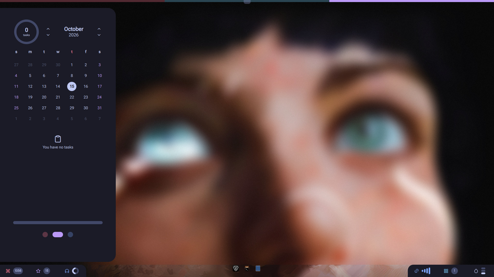

# Quickshell desktop shell

A [Quickshell](https://quickshell.outfoxxed.me/) shell for **Niri** (Mango also works) in the "elena" look. One QML tree provides the workspace strip, bottom bar and dock, sidebars, launcher, power menu, lock screen, notifications and OSD.

## Screenshots

| | |
|---|---|
|  |  |
|  |  |
|  |  |
|  |  |

Regenerate with `bash scripts/screenshots.sh` (needs an empty niri workspace and a running shell).

## What it does

| Surface | File | Notes |
|---|---|---|
| Workspace strip | `bar/Bar.qml`, `bar/TagStripBlocks.qml` | 8 px row at the top edge, one block per niri workspace. Click focuses, right click moves the focused window there, wheel steps. |
| Bottom bar and dock | `bar/BottomBar.qml`, `bar/bottombar/` | 48 px bar: page buttons, volume, dock, clock, battery, network, tray. |
| Left sidebar | `bar/Sidebar.qml`, `bar/sidebar/` | Home, Agenda, Media pages. Also opens from the left screen edge. |
| Settings sidebar | `bar/SettingsSidebar.qml`, `bar/settings/` | Right-edge sidebar, six pages: General, Appearance, Display & Input, Bluetooth, Lock & Power, Notifications. |
| Launcher | `bar/LauncherPopup.qml` | Fuzzy app search; `>` shell actions, `;` clipboard history, `@` wallpapers. |
| Wallpaper filmstrip | `bar/WallpaperFilmstrip.qml` | Full-width picker, opened by `@` or `ipc wallpapers`. |
| Power menu | `bar/PowerMenu.qml`, `bar/powermenu/` | Full-screen menu with confirmation. |
| Lock screen | `bar/LockScreen.qml` | PAM and fingerprint, compositor session lock. |
| Notifications | `bar/NotificationToast.qml` | Toast stack, Do Not Disturb, quiet hours. No history store. |
| OSD | `bar/OsdOverlay.qml` | Volume, brightness, mic, airplane, bluetooth, keyboard backlight. |
| Networks window | `bar/NetworksWindow.qml`, `bar/networks/` | Wi-Fi list, connect, forget, bandwidth, ping. |
| Mic tab, tray | `bar/MicIndicator.qml`, `bar/TrayWindow.qml` | |

Battery alerts (20% and 10%) live in `shell.qml`.

## Layout

```
shell.qml            entry point: ShellRoot, IPC, popup wiring, battery alert
settings.json        persisted preferences (JsonAdapter, config/Settings.qml)
colorscheme          terminal palette selector read by ~/.local/bin/sync-terminal-theme.sh
config/              singletons (Config, Colors, Settings, *Service) and pure *.js models
bar/                 windows and their parts (one subdirectory per surface)
scripts/             triggers, theme/wallpaper sync, helpers, render checks
scripts/niri_config/ python CLI that reads and writes niri kdl (Display & Input tab)
bin/desktop-parser.py  .desktop entries to JSON for the launcher
tests/               node wiring/model tests and QML render harnesses
```

`config/Config.qml` holds fixed layout, type and motion tokens. `config/Settings.qml` holds values that survive a restart. `config/Colors.qml` resolves semantic roles from the Matugen cache (Live) or a fixed palette from `config/PaletteCatalog.js`.

`spacingScale`, `fontPixelSize`, `iconSize` and `reduceMotion` have no UI; edit them in `settings.json`.

## Running it

`~/.config/systemd/user/quickshell.service` starts `/usr/bin/quickshell`, which loads `~/.config/quickshell/shell.qml`. QML edits go live on save. Restart after editing: `systemctl --user restart quickshell.service`.

`quickshell-gpu-watchdog.service` restarts the shell when the i915 render context is lost. `qs-rss-monitor.service` logs memory to `~/.cache/qs-rss/progress.log`.

## Triggers and IPC

Niri binds call `scripts/launcher`, `quickmenu`, `settings`, `lock` and `emit-trigger`. These write a name into `$XDG_RUNTIME_DIR/quickshell` (mode 0700), which `bar/FileTrigger.qml` watches with one `inotifywait`.

| Trigger file | Action |
|---|---|
| `qslauncher-trigger` | toggle launcher |
| `qsquickmenu-trigger` | toggle power menu |
| `qssettings-trigger`, `qscommandcenter-trigger` | toggle Settings |
| `qslock-trigger` | lock |
| `qsosd-vol`, `-bright`, `-mic`, `-airplane`, `-bluetooth` | show that OSD |

`qs ipc call shell <function>`:

| Function | Effect |
|---|---|
| `launcher`, `quickmenu`, `settings`, `lock` | toggle or activate |
| `popup <name>` | toggle `quickmenu`, `launcher`, `sidebar`, `settings`, `networks` or `tray`; `false` for an unknown name |
| `openSidebarPage <n>` | open page `n`, close it if already open, switch otherwise |
| `wallpapers`, `randomWallpaper` | filmstrip, random wallpaper |
| `reloadPalette` | re-read the Matugen cache |
| `dismissPopups`, `currentPopup`, `lockSecure` | state and helpers used by scripts |
| `settingsTab <n>`, `forgetPrompt <name>`, `bottomBarState` | dev and test probes |

## Theme pipeline

`apply-wallpaper.sh` sets the wallpaper (awww), then `sync-active-palette.sh` renders the Matugen cache and runs `~/.local/bin/generate-all-themes.sh` and `sync-theme-mode.sh` for GTK, Qt, Kvantum, kitty, btop and niri. Fixed palettes (Elenapan, Catppuccin, Gruvbox, TokyoNight, Nord, Dracula, Rosé Pine, Everforest, Kanagawa, Solarized) are exported through the same path. `sync-theme-mode-locked.sh` serializes concurrent syncs through `theme-sync-lock.sh`. The Settings Appearance tab starts the sync through `Colors.runPaletteSync()`, so the run survives closing the sidebar. `generate-all-themes.sh` rebuilds icons, Kvantum and GTK/Qt only; the SDDM theme is built by `install-ui-suite.sh`, not on palette changes.

`install-ui-suite.sh` and `install-sddm-integration.sh` (with their `verify-*` twins) install the external Material 3 companions and the SDDM bridge. They use sudo; run them yourself.

## Checks

```
bash scripts/check.sh      # everything below
node tests/<area>/<name>.test.mjs
bash scripts/m3-qmllint-gate.sh
bash scripts/<surface>-render.sh        # scratch HOME, fails on QML errors or overflow
bash scripts/popup-ipc-check.sh         # against the live shell
python3 scripts/qs-rss-report.py        # MB/hour per PID from the rss log; exit 1 on growth
```

Memory: a fresh shell sits near 230 MB RSS (130 MB anonymous). Hot reload inflates the process by tens of MB, so restart before measuring. No per-open leak was found in popup open/close loops.

## Dependencies

Quickshell, Qt 6, Niri, Python 3 (`python-dbus`, `PyGObject` for MPRIS), WirePlumber (`wpctl`), `brightnessctl`, UPower, fprintd, NetworkManager (`nmcli`), `bluetoothctl`, Matugen, awww, ImageMagick, cava, swayidle, `inotify-tools`, cliphist, wl-clipboard, grim, slurp, libnotify. Optional: `playerctl` (media keys), `pavucontrol`, `jq`, `lm_sensors`.

## License

GPL-3.0, see `LICENSE`.
