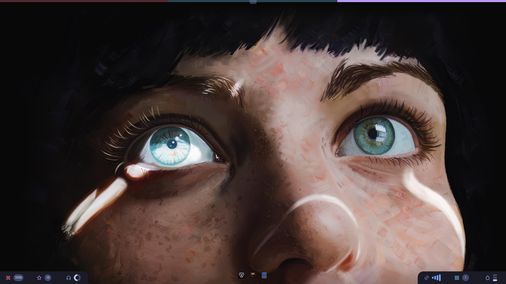
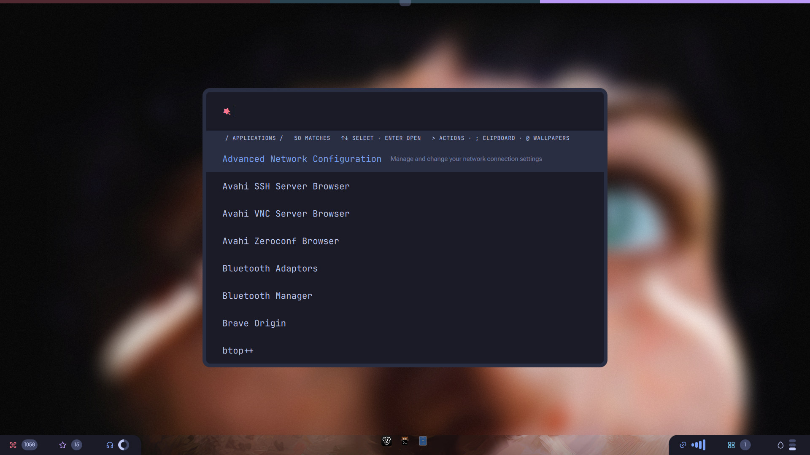
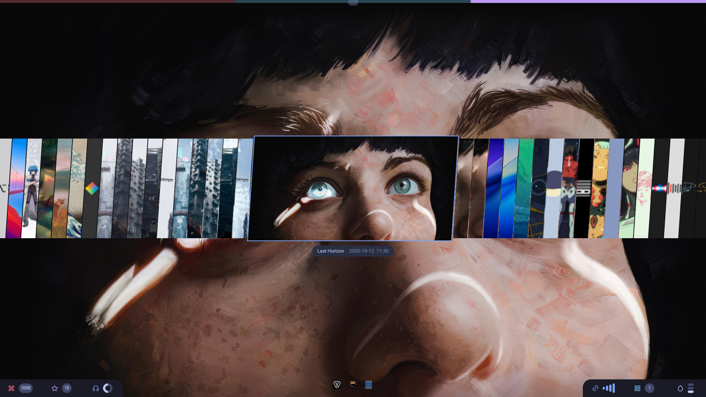
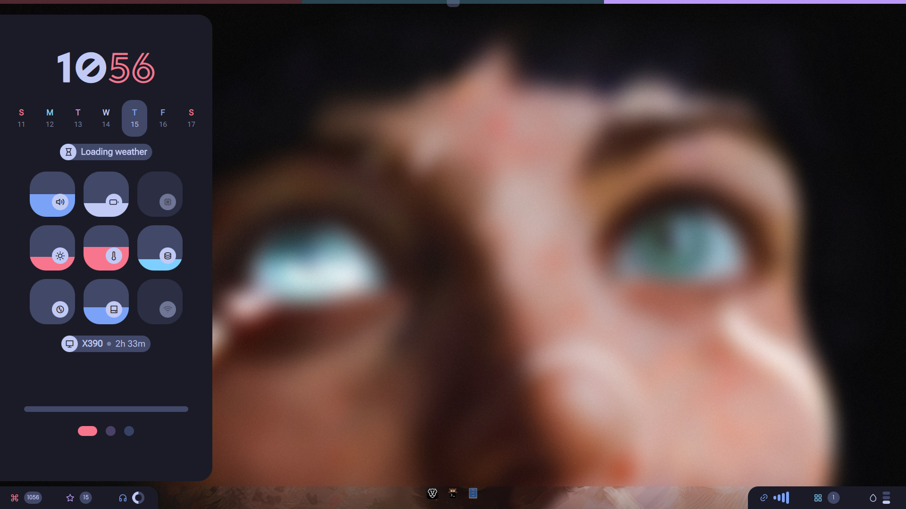
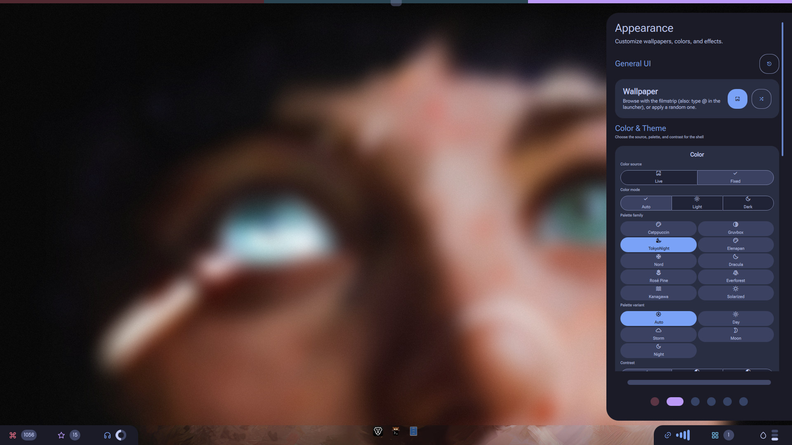
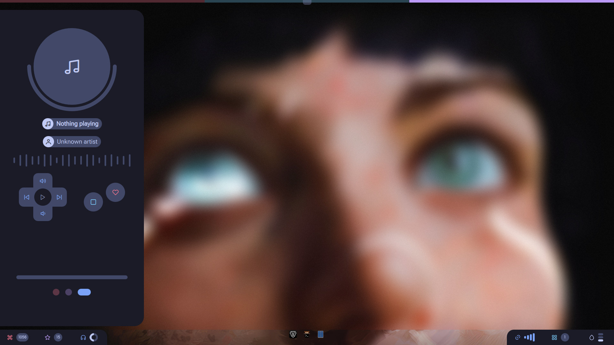
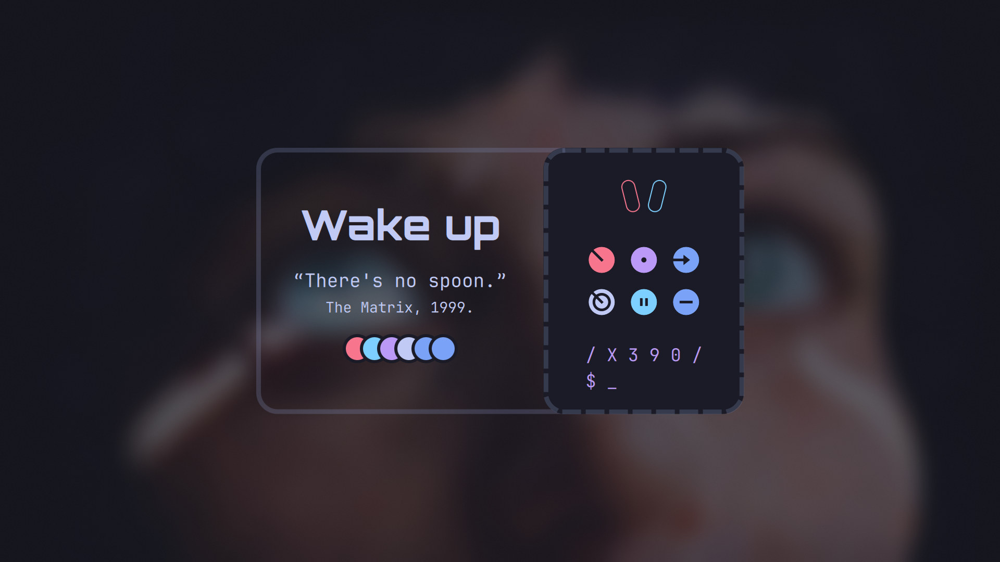

# Dotfiles

My Arch Linux desktop: the [Niri](https://github.com/YaLTeR/niri) compositor with a custom [Quickshell](https://quickshell.outfoxxed.me/) shell, managed with [yadm](https://yadm.io/).



| | |
|---|---|
|  |  |
|  |  |
|  |  |

## What is here

| Path | Contents |
|---|---|
| `.config/quickshell/` | The shell: workspace strip, bottom bar and dock, sidebars, launcher, power menu, lock screen, notifications. See its [README](.config/quickshell/README.md). |
| `.config/niri/` | Compositor config split into `config.kdl`, `keybinds.kdl`, `windowrules.kdl`, `inputs.kdl`, `outputs.kdl`, `startup.kdl`, plus generated `colors.kdl`, `decorations.kdl`, `style.kdl`. |
| `.config/kitty/`, `starship/`, `btop/`, `fastfetch/` | Terminal and CLI configs; kitty, starship and btop colors follow the active palette. |
| `.config/gtk-3.0/`, `gtk-4.0/`, `Kvantum/`, `qt6ct/` | Desktop theme outputs generated from the palette. |
| `.config/nvim/` | LazyVim setup. |
| `.config/systemd/user/` | `quickshell`, GPU hang watchdog, memory monitor, clipboard history, package list refresh. |
| `.config/thinkpad/` | ThinkPad system files: TLP, PAM fingerprint rules, logind, journald, zram, SDDM, backlight rule. The bootstrap copies them to `/etc`. |
| `.local/bin/` | Theme pipeline and small helpers (below). |
| `.zshrc` | Zsh with zinit plugins and the Starship prompt. |
| `pkglist-official.txt`, `pkglist-aur.txt` | Package lists the bootstrap installs; `pkglist-refresh.timer` keeps them current. |

## Theme pipeline

The palette comes from the wallpaper (Matugen) or from a fixed palette chosen in Settings.

1. `.config/quickshell/scripts/apply-wallpaper.sh` sets the wallpaper with `awww`.
2. `.local/bin/matugen-and-cache.sh` renders the light and dark role cache.
3. `.local/bin/generate-all-themes.sh` rebuilds GTK, icon, Kvantum and SDDM outputs.
4. `.local/bin/sync-theme-mode.sh` applies light, dark or auto across GNOME, GTK, Kvantum, Qt, icons, kitty and niri.
5. `.local/bin/sync-terminal-theme.sh` refreshes kitty, starship, btop and Neovim state. It reads `.config/quickshell/colorscheme` (`matugen` or `claude`).

`.local/bin/auto-detect-theme.sh` measures wallpaper brightness for auto mode.

## Install

On a fresh Arch install with `git`:

```bash
yadm clone git@github.com:hekatonkheirex/dotfiles.git
yadm bootstrap     # re-run any time
```

`bootstrap` installs an AUR helper, the package lists, and the system files from `.config/thinkpad` (existing files are saved as `.bak`). It can also clone the Material 3 theme sources into `~/Projects` and install the SDDM themes. Review the PAM, GRUB and udev changes before rebooting.

Without yadm, clone the repo, run `./install.sh`, then copy `.config`, `.local` and `.zshrc` into `$HOME`.

## After changing things

| Changed | Do |
|---|---|
| Quickshell QML | nothing (live reload); `systemctl --user restart quickshell.service` after a long editing session |
| Niri config | nothing (niri reloads on save) |
| Systemd user units | `systemctl --user daemon-reload` |
| `.config/thinkpad` files | re-run `yadm bootstrap` (uses sudo) |

## Known fixes

**OnlyOffice has a thick border under Niri.** OnlyOffice draws its own window frame with a transparent shadow margin of about 28px. Under XWayland, Niri fills that margin with the focus ring color. Launch it with `--system-title-bar` to drop the custom frame. To make the launcher do this, copy the desktop entry and add the flag:

```bash
mkdir -p ~/.local/share/applications
sed 's#^Exec=/usr/bin/onlyoffice-desktopeditors#Exec=/usr/bin/onlyoffice-desktopeditors --system-title-bar#' \
  /usr/share/applications/onlyoffice-desktopeditors.desktop \
  > ~/.local/share/applications/onlyoffice-desktopeditors.desktop
```

Redo this if an OnlyOffice update adds new `.desktop` entries. Restart OnlyOffice for it to take effect.
